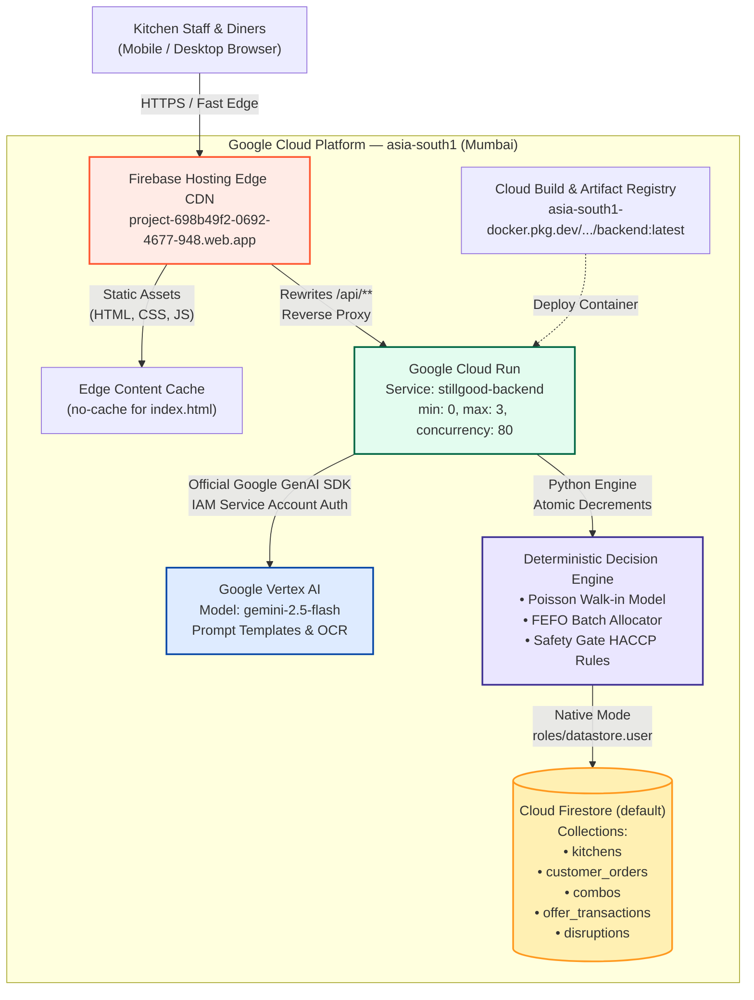

# STILLGOOD — Production Technical Architecture & System Flow

**Last Updated:** October 18, 2026  
**Primary Production URL:** [https://project-698b49f2-0692-4677-948.web.app](https://project-698b49f2-0692-4677-948.web.app)  
**Microservice Endpoint:** [https://stillgood-backend-518727782721.asia-south1.run.app](https://stillgood-backend-518727782721.asia-south1.run.app)  
**Google Cloud Project:** `project-698b49f2-0692-4677-948` (Number: `518727782721`)  
**Deployment Region:** `asia-south1` (Mumbai, India)  
**GitHub Repository:** [https://github.com/Munikanth5/stillgood](https://github.com/Munikanth5/stillgood)

---

## 1. Executive Summary

**STILLGOOD** is an Intelligent Kitchen Decision Twin deployed on Google Cloud. It eliminates avoidable food waste across institutional and commercial kitchens (cafeterias, restaurants, hospitals, buffets) while strictly maintaining food availability, dietary compliance, and food safety standards.

Unlike conventional restaurant software that relies on static checkboxes or estimates 1 generic meal per guest, STILLGOOD combines:
1. **Google Vertex AI (Gemini 2.5 Flash):** Natural-language disruption parsing and structured menu combo generation.
2. **Deterministic Operations Engine:** Mathematical recipe scaling, FEFO (First-Expired, First-Out) inventory allocation, and Poisson walk-in guest forecasting.
3. **Food Safety Gate & Evidence Receipts:** Cryptographic audit receipts, HACCP thermal checks, and human manager approval gates.
4. **Atomic Anti-Oversell Transactions:** Real-time Cloud Firestore updates guaranteeing that surplus meals cannot be double-sold.

---

## 2. Google Cloud Production Architecture

The application is deployed across managed Google Cloud and Firebase services in the Mumbai (`asia-south1`) region:



---

## 3. End-to-End Operational Decision Flow

Every disruption or demand shift follows a strict 8-step decision loop that bridges natural language and deterministic execution:

```mermaid
sequenceDiagram
    autonumber
    actor Staff as Kitchen Staff / Manager
    participant UI as STILLGOOD UI (React/Vite)
    participant API as Cloud Run Backend (FastAPI)
    participant AI as Vertex AI (Gemini 2.5 Flash)
    participant Engine as Deterministic Math Engine
    participant DB as Cloud Firestore (Native Mode)

    Staff->>UI: Enter Disruption ("Strawberries out of stock for 5 days")
    UI->>API: POST /api/ai/interpret
    API->>AI: Structured extraction with validated schema
    AI-->>API: Extracted { ingredient: "strawberries", issue: "unavailable", duration: 5 }
    API-->>UI: Staged Disruption Proposal
    Staff->>UI: Confirm Stock Depleted & Supplier Halted
    UI->>API: POST /api/disruptions/confirm
    API->>DB: Save Disruption & Zero Stock in Firestore
    API->>Engine: Recalculate Menu Demand & Substitute Recipes
    Engine->>Engine: Run FEFO Allocation & Dietary Constraints Gate
    Engine-->>API: Generated MenuPreparationPlan + Cook-Now Portion Advice
    API-->>UI: Return Action Plan ("Fire 2 portions now for active tickets; serve 25 from holding wells")
    Staff->>UI: View "Why this works" Evidence Receipt
```

---

## 4. Deployed Component Specifications

| Architecture Tier | Resource Identifier | Cloud Region | Configuration & Purpose |
| :--- | :--- | :--- | :--- |
| **Edge CDN** | `project-698b49f2-0692-4677-948.web.app` | Global Edge | Serves production single-page application with `no-cache` directives for `index.html` to eliminate stale browser caching. Rewrites `/api/**` to Cloud Run. |
| **Serverless Compute** | `stillgood-backend` | `asia-south1` (Mumbai) | Python 3.13 / FastAPI running in Google Cloud Run. Scale-to-zero (`min-instances: 0`, \$0 idle cost), `max-instances: 3`, concurrency 80. |
| **Foundation AI Model**| `gemini-2.5-flash` | `asia-south1` | Google Vertex AI invoked via official `google-genai` SDK using IAM Default Compute Service Account credentials (`roles/aiplatform.user`). |
| **NoSQL Persistence** | `(default)` database | `asia-south1` (Mumbai) | Cloud Firestore in Native Mode. Manages persistent kitchen profiles, versioned policies, operational facts, customer orders, and transaction audit logs. |
| **Container Registry** | `stillgood-repo` | `asia-south1` | Google Artifact Registry Docker repository storing versioned container builds. |
| **Identity & IAM** | `518727782721-compute@developer.gserviceaccount.com` | Global | Bound to `roles/datastore.user`, `roles/aiplatform.user`, `roles/artifactregistry.writer`, and `roles/storage.admin`. |

---

## 5. Subsystem Deep-Dive

### A. Dynamic Kitchen Context & Disruptions
- **Persistent Policies:** Versioned policies (recipes, capacity, dietary rules, safety protocol) stored per kitchen.
- **Operational Facts:** Dynamic counters (confirmed bookings, walk-ins recorded at the host stand, batches currently holding in warming wells).
- **Temporary Disruptions:** Tracked with unique IDs, start/end timestamps, confirmation status, and verified supplier details.

### B. Menu-Based Demand Planning (Plan My Food)
- **Service Models:** Distinguishes between **À la Carte** (cook-to-order), **Buffet** (batch replenishment), **Fixed-Menu** (attendance-driven), and **Quick-Service**.
- **Dining Realism:** Accounts for appetizers, mains, shared desserts (with fractional sharing factors like 1.5 diners/dish), and attach rates.
- **Three-Tier Decision Output:**
  1. *Ingredients Needed:* Total raw ingredients required for the forecast.
  2. *Preparation Needed:* Mise-en-place components that can be staged cold in advance.
  3. *Cook Now:* Strict ticket-justified portions to cook immediately minus batches already safe in holding wells.

### C. Atomic Rescue Combos & Anti-Overselling
- **Safety Gate:** Food items must pass customer contact checks (unserved behind pass) and thermal holding checks ($\ge 63.0^\circ\text{C}$ hot, $\le 5.0^\circ\text{C}$ cold).
- **Transactional Atomicity:** When a customer orders a discounted rescue combo:
  ```
  Target Combo Available Quantity  ──► Decremented Atomically
  Component Batch Portions Held    ──► Decremented Atomically
  Audit Transaction TX-SG-*        ──► Committed to Firestore
  Excess Orders (Requested > Stock)──► Rejected with HTTP 400 Bad Request
  ```

---

## 6. How It Works in Plain Language (Layman's Guide)

1. **For the Kitchen Chef:**  
   The kitchen doesn't have to guess how many meals to cook. When 70 guests are booked, STILLGOOD analyzes previous sales to predict exactly which dishes people will order. It looks in the kitchen's warm holding wells and says:  
   *"You already have 25 portions of Pomodoro soup hot and ready. Do not cook any more. Only fire 2 Fettuccine Alfredo right now for Table 4."* This keeps food hot, freshly cooked, and eliminates kitchen trash at the end of the shift.

2. **For Sudden Emergencies (Disruptions):**  
   If a supplier calls to say strawberries are ruined, the chef simply speaks or types: *"Strawberries delayed for 5 days."* Gemini automatically identifies all recipes using strawberries, switches the menu to alternative approved desserts, and calculates how to rebalance prep portions—all with one click of manager approval.

3. **For Diners & Sustainability:**  
   High-quality, freshly prepared food that remains unserved behind the pass is bundled into discounted **Rescue Combos** (e.g. 35% off lunch duet). Diners get chef-crafted meals at a discount, the restaurant recovers revenue, and verified plate waste drops to zero.
